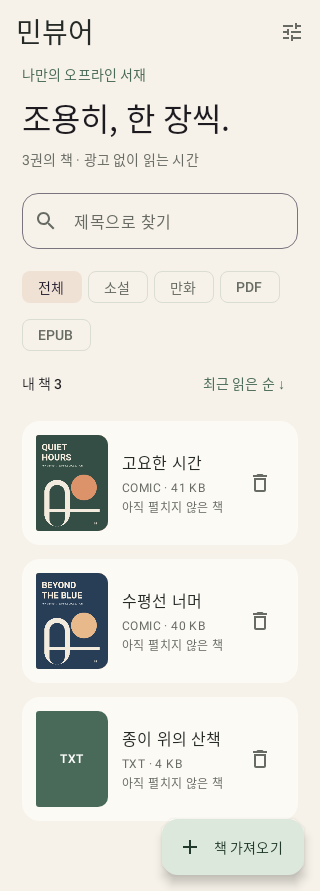
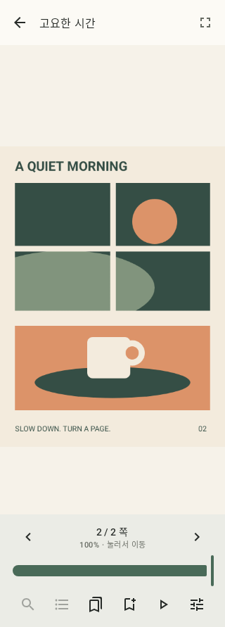

# 민뷰어 · Min Viewer

광고 없이 내 파일을 읽는 개인용 Android 뷰어입니다. Kotlin과 Jetpack Compose로 만들었으며, EPUB 레이아웃은 Readium을 사용합니다.

[GitHub: andongmin94/min-viewer](https://github.com/andongmin94/min-viewer)

## 현재 상태 · 0.2.0

- 서재에서 **실제 표지 미리보기**를 표시합니다. 이미지·ZIP/CBZ는 숫자 파일명 순서의 첫 장, PDF는 첫 페이지, EPUB은 책에 포함된 표지를 사용합니다.
- 긴 만화 이미지는 상단을 잘라 보여 주며, PDF·EPUB 표지는 전체 비율을 유지합니다. TXT나 표지 없는 책은 형식 타일을 표시합니다.
- 미리보기는 화면 작업과 분리해 생성하고 최대 240×320픽셀로 저장합니다. 이미지·PDF는 표지에 필요한 첫 페이지의 정보만 읽습니다. 다시 서재로 돌아오면 저장된 표지를 사용하고, 책을 삭제하면 표지도 함께 지웁니다.
- APK는 [GitHub Releases](https://github.com/andongmin94/min-viewer/releases)에서 배포합니다. `min-viewer-0.2.0.apk`가 설치 파일입니다.

## 화면 미리보기

실제 앱을 실행해 직접 만든 샘플 책을 가져온 화면입니다. Robolectric의 Android 그래픽 렌더링 결과이며, 물리 기기 캡처는 아닙니다.

| 표지가 보이는 서재 | 만화 읽기 |
| --- | --- |
|  |  |

## APK 설치

1. [Releases](https://github.com/andongmin94/min-viewer/releases)의 **Assets**에서 `.apk`를 받습니다. 자동 생성되는 Source code 압축파일은 설치 파일이 아닙니다.
2. Android 8.0 이상 기기에서 APK를 열고, Android가 요청하면 해당 파일을 연 앱의 설치 권한을 허용합니다.
3. 책 가져오기에서 TXT·이미지·ZIP/CBZ·PDF·EPUB 파일이나 폴더를 선택합니다.

**0.2.0은 새 릴리스 서명키를 사용합니다.** 이전 0.1.3 이하 개발용 APK와 서명이 달라 덮어쓰기 업데이트는 되지 않습니다. 기존 앱을 삭제하면 서재 사본·책갈피·읽던 위치·설정도 삭제되므로, 기존 독서 데이터가 필요하면 이전 설치본을 지우지 마세요. 원본 책 파일은 앱 바깥에 따로 남아 있습니다. 0.2.0부터는 보관된 동일한 릴리스 키로 업데이트를 배포합니다.

## 읽을 수 있는 파일

| 형식 | 읽기 기능 |
| --- | --- |
| TXT | 한국어 인코딩 감지/선택, 페이지·스크롤, 본문 검색, 글꼴/크기/줄 간격/여백, 문자 위치로 이어 읽기 |
| ZIP / CBZ | 압축 내부 JPG·JPEG·PNG·WEBP, 숫자 파일명 정렬, 좌우 읽기, 확대, 긴 이미지 연속 읽기 |
| JPG / JPEG / PNG / WEBP | 개별 이미지, 여러 이미지 또는 이미지 폴더를 한 권으로 가져오기 |
| PDF | 페이지·세로 연속 읽기, 확대 후 다시 렌더링, 페이지 이동, 이어 읽기 |
| EPUB | Readium의 EPUB 2/3 렌더링, 목차·본문 검색, Locator 위치 복원. 재조판형 EPUB의 페이지·스크롤과 서체/색상 설정 |

모든 형식에 책갈피, 진행률 이동, 페이지/위치 번호 입력, 볼륨키 조작, 좌우 터치 영역, 자동 읽기, 화면 밝기·추가 어둡기 설정을 연결했습니다. TXT와 재조판형 EPUB은 글자 설정을 바꿀 수 있습니다. 고정 레이아웃 EPUB·이미지·PDF의 인쇄된 글자는 재조판하지 않습니다.

## 사용 방법

1. **책 가져오기**에서 파일이나 폴더를 고릅니다. 파일은 앱 서재로 복사하며 원본을 변경하지 않습니다.
2. 이미지만 여러 장 선택하면 하나의 CBZ로 묶습니다. 폴더는 하위 폴더까지 확인하고, 문서 개수와 이미지 폴더 개수를 보여 준 뒤 가져옵니다.
3. 책을 열고 화면 가운데를 누르면 도구가 나타납니다. `어디든 다음` 모드에서도 하단 도구 버튼으로 메뉴를 열 수 있습니다.
4. 하단에서 검색, 목차, 책갈피, 자동 읽기, 설정을 사용합니다. 진행률 바나 페이지 번호를 눌러 이동합니다.
5. **세로 스크롤**로 바꾸면 TXT는 연속 본문, 만화는 웹툰식 긴 화면, PDF는 연속 페이지로 읽습니다.
6. 볼륨 아래 버튼은 기본적으로 다음으로 이동합니다. 설정에서 켜고 끄거나 방향을 바꿀 수 있습니다.

설정은 기기에 저장됩니다. 책갈피와 마지막 읽던 위치는 책마다 따로 저장하며, 앱 종료 때 최신 위치를 저장합니다. 서재에서 책을 지우면 가져온 사본과 그 책의 책갈피만 삭제합니다. 앱을 삭제하면 앱 안의 서재·설정도 삭제되며, 원본 파일은 남습니다.

## 범위

- Android 8.0(API 26) 이상.
- 계정, 광고 SDK, 분석 SDK, NAS, 서버, 클라우드 동기화가 없습니다. 앱은 `INTERNET` 권한을 요청하지 않습니다.
- EPUB의 페이지 표시에는 글꼴과 무관한 **Readium 위치 번호**를 사용합니다. 고정 레이아웃 EPUB은 발행된 고정 페이지 방식으로 읽습니다.
- EPUB에 포함된 본문·이미지를 읽으며, 외부 URL의 자료와 웹페이지는 불러오지 않습니다.
- PDF/만화 본문 OCR·검색, RAR/7z, DRM으로 잠긴 EPUB은 지원하지 않습니다.
- 압축 만화는 ZIP/CBZ 안에 이미지가 있는 형식을 사용합니다. TXT가 들어 있는 ZIP은 먼저 TXT를 꺼내 가져옵니다.
- 자동 읽기는 다른 화면이나 설정을 보는 동안 멈추며, 책 끝에서는 종료됩니다. 속도와 한 장당 읽는 시간은 설정에서 조정합니다.
- 직접 지정한 배경·글자 색과 가져온 TTF/OTF 글꼴을 사용할 수 있습니다.

## 개발 환경과 빌드

- JDK 21
- Android SDK Platform 37.0, Build Tools 37.0.0
- Android Gradle Plugin 9.3.1 / Gradle Wrapper 9.7.0
- Kotlin 2.4.20 / Compose 1.12.0 / Material 3 1.4.0
- Readium Kotlin Toolkit 3.4.0

최근 Android Studio에서 이 폴더를 프로젝트로 열고 SDK를 설치합니다. `local.properties`는 Android Studio가 로컬 SDK 경로에 맞춰 만듭니다. 외부 서비스 키나 계정 설정은 필요하지 않습니다.

```bash
./gradlew :app:assembleDebug
./gradlew :app:testDebugUnitTest :app:lintDebug
```

Windows에서는 `gradlew.bat`를 사용합니다. 설치할 파일은 `app/build/outputs/apk/debug/app-debug.apk`입니다. 연결한 휴대전화에는 Android Studio의 Run 또는 아래 명령으로 설치할 수 있습니다.

```bash
adb install -r app/build/outputs/apk/debug/app-debug.apk
```

### 릴리스 빌드

릴리스 서명키와 비밀번호는 저장소에 넣지 않습니다. `min-viewer` 별칭의 PKCS12 키를 아래 환경변수로 지정한 뒤 빌드합니다.

```bash
export MIN_VIEWER_KEYSTORE_FILE="/absolute/path/min-viewer-release.p12"
read -r -s -p "Keystore password: " MIN_VIEWER_KEYSTORE_PASSWORD
export MIN_VIEWER_KEYSTORE_PASSWORD
./gradlew :app:assembleRelease
```

결과는 `app/build/outputs/apk/release/app-release.apk`입니다. 서명 설정이 없으면 릴리스 빌드는 실패합니다. 배포한 앱을 업데이트하려면 반드시 기존 릴리스와 같은 키를 사용해야 합니다. 디버그 APK는 개발 환경의 별도 키를 사용합니다.

Android 설치 식별자는 `kr.goyo.reader`이며, 앱 표시 이름과 별도로 관리합니다.

## 코드 구조

```text
app/src/main/java/kr/goyo/reader/
  model/                 독서 위치, 책, 설정, 뷰어 명령
  data/                  파일 가져오기, 서재·책갈피·설정 저장
  reader/text/           텍스트 디코딩과 네이티브 페이지 계산
  reader/visual/         이미지·압축파일, 자연 정렬과 영역 렌더링
  reader/epub/           Readium 파싱, 목차·검색, Fragment 연결
  ui/                    서재, 공통 독서 도구, 설정
```

설정과 서재 메타데이터는 AndroidX DataStore에 저장합니다. TXT는 문자 위치, 이미지/PDF는 페이지와 내부 위치, EPUB는 Readium Locator 전체를 보관합니다. PDF는 Android의 `PdfRenderer`, 이미지는 `BitmapFactory`/`BitmapRegionDecoder`를 사용합니다.

## 검증

단위·Robolectric 테스트는 한글 인코딩, 이모지/문자 위치, 실제 `StaticLayout` 페이지 크기, 자연 정렬·이미지 분할, 서재 직렬화·원본 보존, 중복 파일명 가져오기, 실제 EPUB 목차·검색·Locator를 확인합니다.

0.2.0 검증 결과: 관련 JVM·Robolectric 검사 **15개 통과**, 릴리스 APK와 Android 기기용 테스트 APK 빌드 성공, 린트 **오류 0개·경고 4개**입니다. Android 기기용 픽셀 검사 2개는 컴파일만 확인했으며 실제 기기에서 실행하지 않았습니다. 변경 범위의 검사 명령은 아래와 같습니다.

```bash
./gradlew :app:testDebugUnitTest \
  --tests kr.goyo.reader.BookCoverCacheTest \
  --tests kr.goyo.reader.LibraryPreviewTest \
  --tests kr.goyo.reader.LibraryRepositoryTest \
  --tests kr.goyo.reader.ReaderFlowTest
./gradlew :app:assembleRelease :app:lintRelease :app:assembleDebugAndroidTest
```

- JVM에서는 실제 PNG·CBZ·EPUB의 첫 이미지·표지, 크기 제한, 디스크 캐시 재사용·삭제, 뒤쪽 이미지가 손상된 CBZ의 첫 표지를 확인합니다.
- 실제 앱에서 이미지 책 가져오기 → 서재 표지 표시 → 책 열기 → 다음 페이지 이동을 확인하며 `app/build/outputs/screenshots/`에 화면을 저장합니다.
- 기존 서재의 원본 보존·직렬화, TXT 책갈피·이어 읽기 흐름을 함께 확인합니다.
- PDF 첫 페이지와 긴 이미지 상단의 실제 픽셀은 `BookCoverRenderingTest`의 Android 기기용 검사 2개로 분리했습니다. Robolectric 4.16.1은 해당 네이티브 PDF·영역 디코더를 구현하지 않습니다. 기기나 에뮬레이터를 연결한 뒤 `./gradlew :app:connectedDebugAndroidTest`로 실행할 수 있습니다. 이번 작업에서는 연결된 기기가 없어 이 두 검사의 실제 실행은 하지 않았습니다.

EPUB 자동 읽기의 종료 판단은 Readium 3.4.0의 페이지 콜백·읽기 방향·고정 레이아웃 동작을 기준으로 코드 검토와 빌드를 확인했습니다. WebView에서의 실제 EPUB 표시·자동 읽기·검색 중 백그라운드 전환, 휴대전화의 제스처·볼륨키·밤 밝기·사용자 글꼴은 실기기 검증이 남아 있습니다. JVM/Robolectric 테스트는 물리 기기의 렌더링·메모리 검증을 대신하지 않습니다.

## 참고한 공식 구현

- [Jetpack Compose](https://developer.android.com/compose)
- [Readium Kotlin 3.4.0](https://readium.org/kotlin-toolkit/3.4.0/)
- [Android PdfRenderer](https://developer.android.com/reference/android/graphics/pdf/PdfRenderer)
- [juniversalchardet](https://github.com/albfernandez/juniversalchardet)

Readium과 문자 인코딩 감지기의 라이선스 안내는 `app/src/main/assets/licenses/`에 포함합니다. 그 외 직접 사용하는 AndroidX/Kotlin 라이브러리는 Apache 2.0 라이선스로 배포됩니다.
